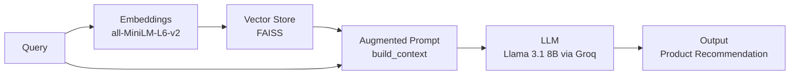
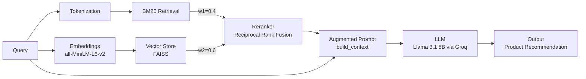

# &#127918; Video Game Product Query Assistant

## Overview

This project builds an interactive web app through which users can interact with a video game product search assistant. The assistant implements three retrieval methods: BM25 keyword search, semantic search, and a hybrid RAG 
(Retrieval-Augmented Generation) pipeline to retrieve and generate product recommendations from Amazon video game reviews and metadata.

## Dataset Description

The dataset that is being used in this project is the Video Games category from the Amazon Reviews dataset, collected in 2023 by [McAuley Lab](https://cseweb.ucsd.edu/~jmcauley/). This dataset contains 2.8M user reviews and 137.2k items.
It can be found and downloaded at the following address : [amazon-reviews-2023](https://amazon-reviews-2023.github.io)

> **Note:** Data files are not included in this repository due to file size constraints.
> Please download them with the instructions below.

## Data Preprocessing

The preprocessing implementation can be found in the [src/preprocess.py](src/preprocess.py) module.

The preprocessing steps are as follows :
- process the item meta data :
    - extract item type, ESRB rating and date first available from `details` field from the item meta data 
    - change the `price` field type to string 
    - drop unused columns 
    - rename title `column` to `item_title`
- process the user reviews :
    - keep only verified purchases (`verified_purchase==True`)
    - drop unused columns 
    - rename title `column` to `review_title`
    - group reviews by product
- merge the two datasets (user reviews and item meta data) 
- preprocess the data
    - transform text to lowercase
    - removes all elements that aren't lowercase letters, numbers or whitespace
    - if the given text is a list, transforms it into a string

More information about preprocessing can be found in the [Data exploration and preprocessing](notebooks/milestone1_exploration.ipynb) notebook.

The following fields were used in the product retrieval workflow:


- User reviews :
    - title
    - text
    - parent_asin
    - verified_purchase
- Item meta data:
    - title
    - average_rating
    - rating_number
    - features
    - description
    - price
    - store
    - categories
    - details
    - parent_asin

More information about field selection can be found in the [Data exploration and preprocessing](notebooks/milestone1_exploration.ipynb) notebook.

### Dataset Size

**Important Note**: The dataset is processed at the product level, all reviews for the same product are aggregated into a single row, so there are approximately 130K unique products after processing. As a result, we recommend running the workflow on a machine with a minimum of 16 GB RAM. The web app may crash or run slowly on machines with 8GB RAM due to the memory required to load both the FAISS and BM25 indexes simultaneously.

## RAG Workflow

We use `llama-3.1-8b-instant` via the Groq API for LLM inference. This model was chosen because it runs remotely (no local RAM usage). For full rationale on Model choice, see the milestone 2 discussion [notebook](https://github.com/UBC-MDS/DSCI_575_project_nourabd_mailysg/blob/main/results/milestone2_discussion.md).

### Semantic RAG Pipeline 



The semantic RAG pipeline retrieves relevant products using FAISS vector store similarity search, builds a structured context block from the retrieved product reviews and metadata, and passes it to the LLM to generate a product recommendation.

### Hybrid RAG Pipeline 


The hybrid RAG pipeline combines BM25 keyword search and semantic search using LangChain's `EnsembleRetriever` with Reciprocal Rank Fusion (RRF) reranking. BM25 is weighted at 40% and semantic search at 60% because we found that that semantic search alone, tends to perform better on a mix of different user queries (see milestone 1 discussion notebook for more details). These reranked results are passed to the LLM to generate product recommendations.

> **Note:** The RAG pipeline is implemented across separate files rather than a  single `src/rag_pipeline.py`. We did this for better modularity and readability of our scripts:
> - `src/semantic_rag_pipeline.py`: Semantic RAG pipeline (FAISS retriever + LLM)
> - `src/hybrid_rag_pipeline.py`: Hybrid RAG pipeline (BM25 + FAISS + LLM)
> - `src/hybrid.py`: Hybrid retriever definition (EnsembleRetriever with RRF)
> - `src/context_builder.py`: Context building function
> - `src/prompts.py`: Prompt template

## Retrieval Workflows

### BM25 Search 

BM25 is a keyword-based retrieval algorithm that scores documents based on term frequency and inverse document frequency. It uses a lexical index built with LangChain's `BM25Retriever` and is saved as a pickle file. It tokenizes the query and matches against metadata and reviews in our product corpus. Results using BM25 on example queries can be found in `results/bm25_results.csv`.

### Semantic Search 

Semantic search uses vector embeddings to find products that are semantically similar to a user's query, even when keywords don't match. Documents are indexed using FAISS with L2 distance where a lower score indicates that they are more similar.Results using Semantic search on example queries are saved to `results/semantic_results.csv`.

## Instructions

### Downloading the datasets
To download the data, follow the instructions below :
1. Clink on the link to navigate to the Video Games dataset website : [Video Games dataset](https://amazon-reviews-2023.github.io/#:~:text=review%2C%20meta-,Video_Games,-2.8M)

2. Download the files by clicking on `review` and `meta` (as pictured below)

    

You should now have 2 files downloaded : `Video_Games.jsonl` and `meta_Video_Games.jsonl`. Make sure to place these in the repository's **raw** data folder. 

Instructions for loading the dataset can be found here : [Loading instructions](https://amazon-reviews-2023.github.io/#quick-start)

### Setting up
To set up the workflow, follow the instructions below :

1. Clone the repository :

    ```bash
    git clone https://github.com/UBC-MDS/DSCI_575_project_nourabd_mailysg.git
    ```

2. Navigate to the project directory locally :

    ```bash
    cd DSCI_575_project_nourabd_mailysg
    ```

3. Install the required dependencies :

    ```bash
    conda env create -f environment.yml
    conda activate 575-proj
    ```

4. Put the files `Video_Games.jsonl` and `meta_Video_Games.jsonl` downloaded above in the `data/raw` folder 

5. Create a `.env` file in the project root and add your **Groq API key**:

> A free API key can be obtained at [console.groq.com](https://console.groq.com). Follow the steps to generate a free-tier API key. Please note that since it is a free tier token, rate limit constraints apply.

The `.env` file should contain: ```GROQ_API_KEY=your_key_here```

### Running the workflow
To run the workflow, follow the instructions below :

1. Create the preprocessed corpus :

    ```{bash}
    python src/preprocess.py
    ```

2. Run the retrieval workflows :
    - BM25 search  :
    
    ```{bash}
    python -m src.bm25 
    ```
    - Semantic search  :
    
    ```{bash}
    python -m src.semantic 
    ```

The results of the semantic search and BM25 search workflows can be found in the [results](results) folder. The scripts should also produce 2 folders ```faiss_index``` and ```bm25_index``` with the retriever, pkl and index files that will be used to run the app. 

To view example query results from the Hybrid RAG worflow, please refer to the data exploration [notebook](https://github.com/UBC-MDS/DSCI_575_project_nourabd_mailysg/blob/main/notebooks/milestone2_rag.ipynb). Otherwise, try the RAG system out by querying the app. See below instructions.

### Running the App
To run the web app, follow the instructions below :

1. To run the app locally :
    ```{bash}
    streamlit run app/app.py 
    ```

The app has two modes:
- **Search Mode**: BM25 and Semantic search
- **RAG Mode**: Hybrid RAG pipeline with LLM generated recommendations

2. This should automatically open a new window with the web app in your browser.
3. To stop the app, press `ctrl` + `C` in the terminal.